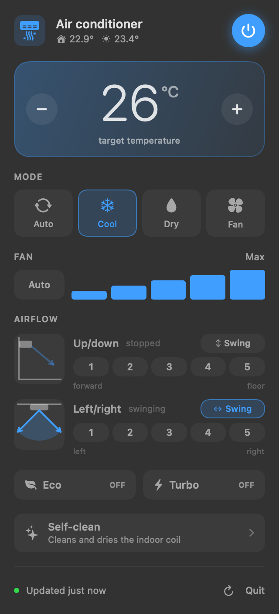
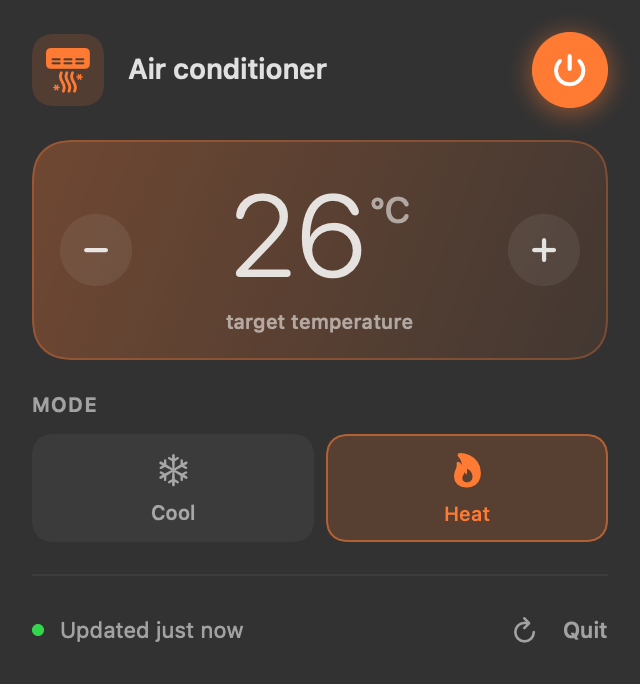

[English](README.md) · **Português**

# Clima

Controle o ar-condicionado **pela rede local**, sem depender do app do fabricante. Dá para usar pelo terminal (`clima`) ou por um painel na barra de menus do macOS.

<p align="center">
  
  &nbsp;&nbsp;
  
</p>

- **Vários fabricantes (providers).** Hoje vêm o **Midea** (Midea, Springer Midea, Carrier, Comfee...) e o **demo**, um aparelho simulado. Para plugar um fabricante novo, basta implementar uma interface; o resto não muda.
- **O painel se adapta ao aparelho.** Cada controle só aparece se o provider declarar aquela função. Acima, à esquerda, um aparelho completo; à direita, um provider que só tem modo e temperatura.
- **Funções desligáveis.** Qualquer função pode ser escondida pela configuração (`disabled_features`).
- **100% local** depois da configuração inicial.

> A interface do CLI e do widget é em inglês; esta documentação também existe [em inglês](README.md).

## Instalação

Requisitos: **macOS 14+**, **Python 3.10+** (`brew install python`) e as **Command Line Tools** (`xcode-select --install`) para compilar o widget.

```sh
git clone https://github.com/jovenan/clima.git
cd clima
./install.sh
clima setup
```

O `install.sh` faz quatro coisas:

1. cria um ambiente Python isolado em `~/.local/share/clima`;
2. cria o comando `clima` em `~/.local/bin`;
3. compila o app e instala o `Clima.app` em `~/Applications`;
4. abre o widget e configura para ele iniciar no login.

O `clima setup` encontra o aparelho na rede e pede o e-mail e a senha do app do fabricante. Elas são usadas **uma única vez**, para obter a chave do aparelho, e a senha não é salva.

Sem aparelho? Experimente com o simulador (aparece como *Simulator (no device)*):

```sh
clima setup --provider demo
```

Opções do instalador:

| Comando | O que faz |
|---|---|
| `./install.sh --no-app` | só o comando `clima`, sem widget |
| `./install.sh --no-login` | não abre o widget automaticamente no login |
| `./install.sh --extras ""` | não instala dependências de providers (ex.: só o demo) |
| `./uninstall.sh` | remove tudo, mas mantém a configuração (`--purge` apaga também) |

> Se aparecer o aviso `⚠ Add to your shell: export PATH=...`, adicione `export PATH="$HOME/.local/bin:$PATH"` ao seu `~/.zshrc`.

## Uso no terminal

```sh
clima                         # estado atual
clima on cool 23 fan auto     # liga no frio, 23°C, ventilação automática
clima off
clima 22.5                    # só a temperatura
clima vertical 2              # aleta de cima/baixo na posição 2
clima horizontal swing        # aleta de esquerda/direita oscilando
clima eco on
clima clean on                # autolimpeza
clima --json                  # estado + capacidades em JSON (bom para scripts)
clima providers               # providers disponíveis
clima help                    # todos os comandos
```

O `clima status` mostra só as linhas que o aparelho suporta, por exemplo: `Power`, `Mode`, `Target`, `Indoor`, `Outdoor`, `Fan`, `Airflow`, `Eco`, `Turbo` e `Self-clean`.

As palavras podem ser combinadas em qualquer ordem, e as da direita têm prioridade. Duas regras para lembrar:
- **Escolher um modo liga o ar**, a menos que o comando tenha `off`.
- **`fan` tem dois sentidos:** sozinho, é o modo Ventilar; seguido de uma velocidade (`fan low`), muda só a ventilação.

## Widget da barra de menus

O ícone mostra o modo e a temperatura alvo (ex.: `❄ 23°`). Ao clicar, abre o painel:

- **Liga/desliga e temperatura.** Use `−`/`+` ou as setas ↑/↓; cliques rápidos viram um único comando.
- **Mode e Fan:** modo e ventilação.
- **Airflow:** direção do ar em dois eixos, cada um com um desenho ao vivo do aparelho e do jato de ar:
  - **Up/down**: posições 1–5, de *forward* (para frente) até *floor* (para o chão);
  - **Left/right**: posições 1–5, de *left* até *right*;
  - o botão **Swing** faz o eixo oscilar.
- **Eco, Turbo e Self-clean.** A autolimpeza pede dois toques para iniciar.
- **Refresh (`⌘R`) e Quit (`⌘Q`)** no rodapé.

A tela reage na hora e confirma com o aparelho em segundo plano. Se um comando falhar, ela volta ao estado real e mostra o erro num aviso com o botão **Retry**.

```sh
# reabrir depois de "Quit"
launchctl kickstart "gui/$(id -u)/dev.clima.app"
# logs
tail -f ~/Library/Logs/clima.log
```

## Configuração

Fica em `~/.config/clima/config.json`. Para usar outro caminho, defina a variável `CLIMA_CONFIG`.

```json
{
  "provider": "midea",
  "settings": { "ip": "192.168.1.50", "port": 6444, "device_id": 123456789, "token": "…", "key": "…" },
  "disabled_features": ["turbo"]
}
```

`disabled_features` esconde funções no widget e no CLI. Valores aceitos: `power`, `target_temperature`, `mode`, `fan_speed`, `swing_vertical`, `swing_horizontal`, `louver_vertical`, `louver_horizontal`, `eco`, `turbo`, `self_clean`, `indoor_temperature` e `outdoor_temperature`.

O provider demo aceita `settings.features` e `settings.modes`, para simular aparelhos mais simples:

```json
{ "provider": "demo", "settings": { "features": ["power", "mode", "target_temperature"], "modes": ["cool", "heat"] } }
```

## Adicionar um fabricante

Implemente `ClimateProvider` (quatro métodos obrigatórios), declare o que o aparelho suporta em `capabilities()` e registre a classe. O guia completo, com exemplo, está em **[docs/PROVIDERS.pt-BR.md](docs/PROVIDERS.pt-BR.md)**. O provider também pode morar num pacote separado e ser descoberto por *entry point*, sem mexer neste repositório.

## Desenvolvimento

```sh
make dev          # .venv com o pacote em modo editável
make app          # recompila o Clima.app
```

Para testar mudanças sem aparelho, use o provider demo: `CLIMA_CONFIG=/tmp/demo.json` com `{"provider": "demo"}`.

```
clima/
├── src/clima/
│   ├── core/          # domínio, sem fabricante: modelos, contrato, validação, registro, serviço
│   ├── providers/     # adapters: demo.py, midea/
│   ├── cli/           # parser (puro), formatação, terminal, main
│   ├── bridge/        # protocolo JSON por linha usado pelo widget
│   └── factory.py     # monta o serviço a partir da configuração
├── app/               # widget SwiftUI (pacote SwiftPM)
│   ├── Sources/ClimaKit/   # Model, Backend, Store, Views (uma seção por arquivo)
│   └── Sources/Clima/      # o app
├── docs/              # ARCHITECTURE, PROVIDERS (em inglês e pt-BR)
└── install.sh / uninstall.sh / Makefile
```

A arquitetura e os padrões de projeto usados estão em **[docs/ARCHITECTURE.pt-BR.md](docs/ARCHITECTURE.pt-BR.md)**.

## Solução de problemas

| Sintoma | Causa provável e solução |
|---|---|
| "the device did not respond" | O IP pode ter mudado. Rode `clima setup` de novo e reserve o IP do aparelho no roteador. |
| "'clima setup' requires an interactive terminal" | Rode no Terminal/iTerm, não por scripts ou pelo `!` de outras ferramentas. |
| Ventilação "set by the device" | Alguns aparelhos (o Midea, por exemplo, no modo Seco) controlam a ventilação sozinhos. |
| Primeiro comando após um tempo parado demora ~3 s | O aparelho fecha conexões ociosas; a reconexão é automática. |
| Widget não aparece (Mac com notch) | O ícone pode estar escondido atrás do notch. Rode `defaults write dev.clima.app "NSStatusItem Preferred Position Item-0" -float 250` e reabra o widget; ou libere espaço na barra. Para mudar a posição depois, arraste o ícone segurando ⌘. |
| Widget não abre | Veja `~/Library/Logs/clima.log` e confira se "Clima" está permitido em Ajustes → Geral → Itens de Início. |

## Licença

[MIT](LICENSE) © 2026 Jonatas Venancio.
